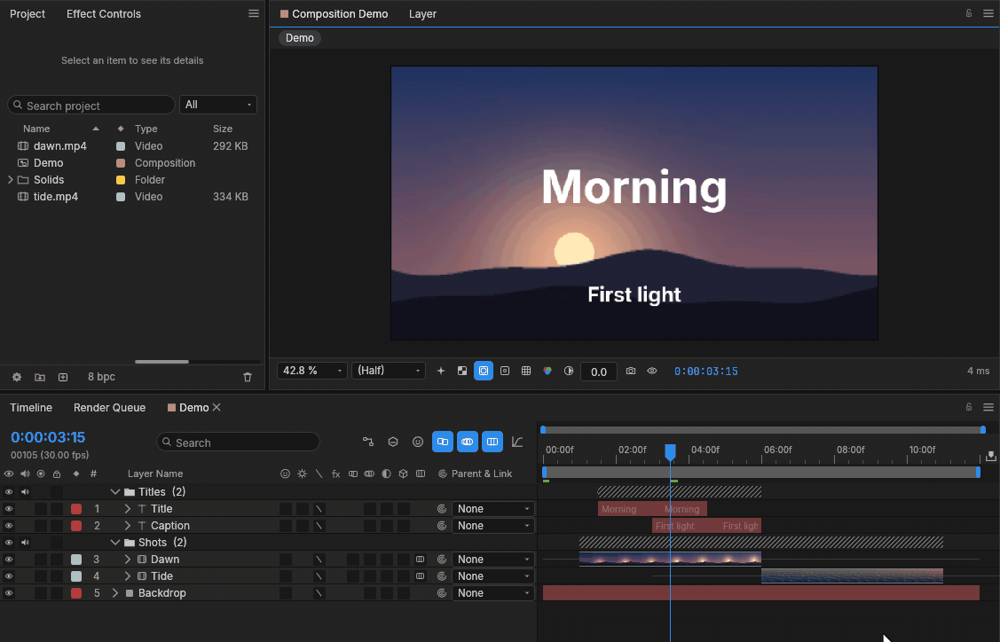
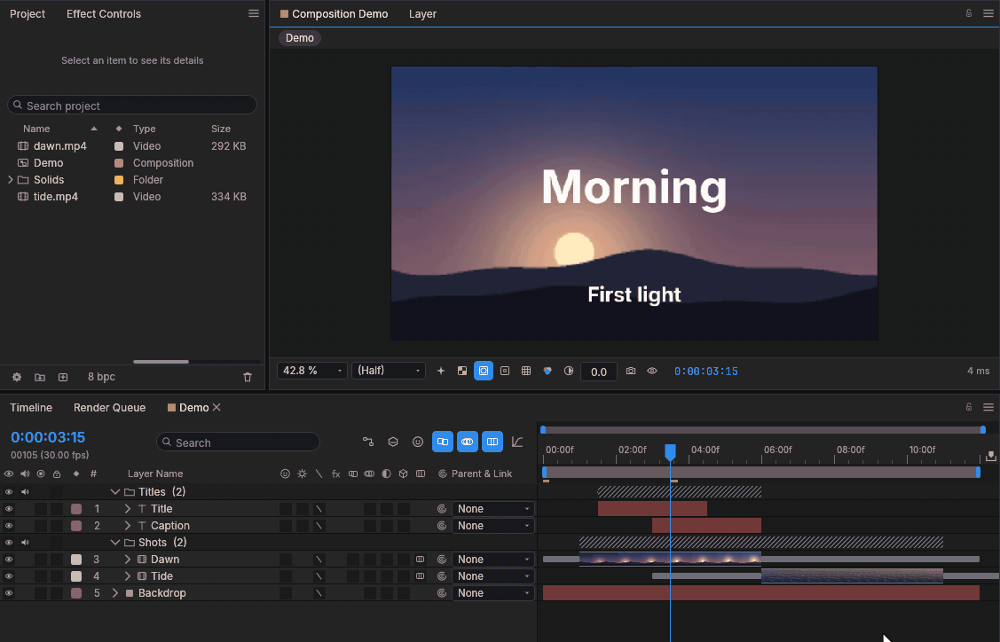
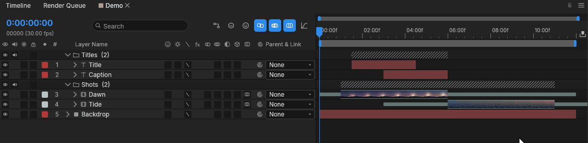
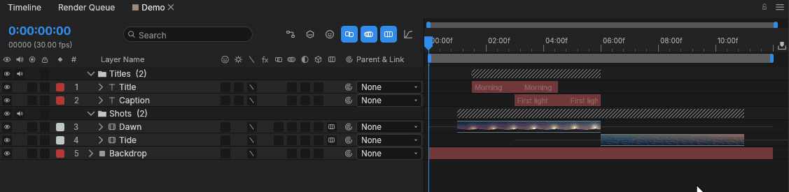
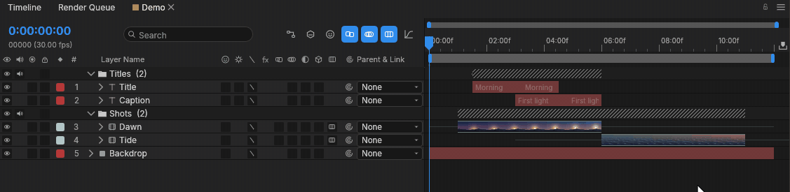
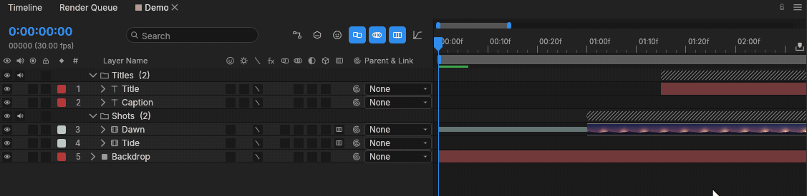
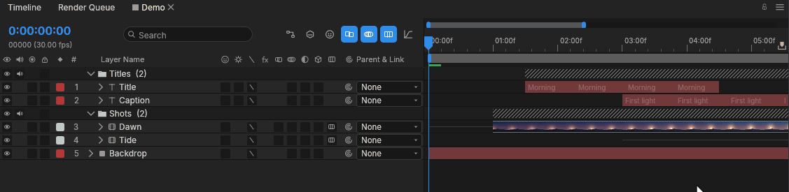
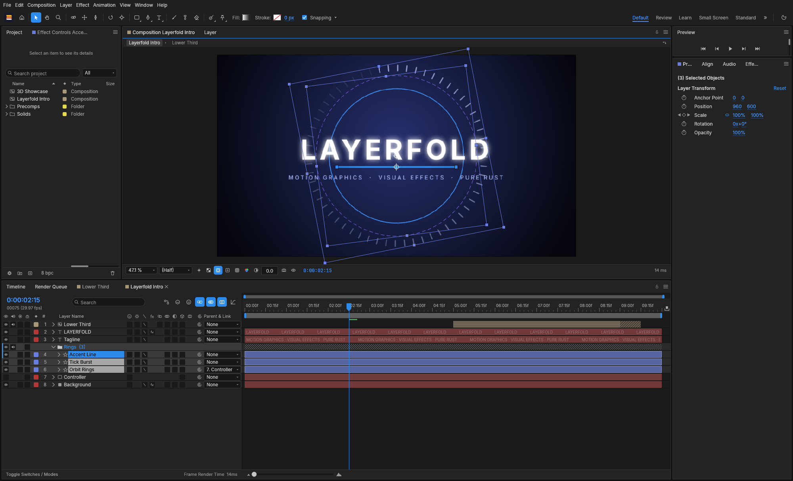

<p align="center">
  
</p>

<p align="center">A motion graphics and compositing editor for Windows, written in Rust and based on <a href="https://github.com/storytold/effectcraft">EffectCraft</a>.</p>

> [!IMPORTANT]
> This is an independent project. It is not the official EffectCraft, and the ArtCraft team neither
> makes nor supports it. Please report problems with Layerfold [here](https://github.com/mrbassvilleport/layerfold/issues),
> not to them. The official project is [storytold/effectcraft](https://github.com/storytold/effectcraft).

## What it adds

Layerfold is EffectCraft 0.22.0 with changes to how the timeline works. Compositions, the 308 effects, 3D,
expressions and export all come from EffectCraft. The animations below were filmed from the program
itself, with only the cursor and the caption added on top. [CHANGES.md](CHANGES.md) has the full list.

### Layer groups

A timeline with thirty layers gets hard to read, so layers can live in groups, and groups inside
groups. A group has its own Video, Audio and Lock switches, and its bar shows where its layers sit in
time, even when it is collapsed. Its icon is a filled folder, so a group stands out from the layers
around it. Layers go in and out by dragging.



### Slip

Alt+drag changes which moment of the video a clip shows. The clip stays where it is, and so do its
keyframes, so an animation built for that stretch of the timeline plays over the new moment. That
last part differs from After Effects on purpose.



### Snapping with Shift

Hold Shift while dragging a layer or a keyframe and its edges snap to the playhead, other layers,
keyframes and group edges within 8 pixels. A line and a label show what it caught.



### Clip edges that know where the video ends

An edge stops at the start or end of the source, so you see when you run out of footage. Keep pulling
and it goes past into a frozen frame, drawn hatched. Layer ▸ Time ▸ Trim to Source stretches a clip
to the whole video. A thin, faint line along the track shows how far the source reaches past the clip.



### Frames on the tracks

Video layers show their frames on the track. One button turns them off for the timeline and a switch
turns them off for one layer. Frames that aren't drawn aren't decoded.



### Panning with the middle button

Drag with the middle mouse button anywhere in the timeline to move through time and through the
layer list.



### Text on the bars

A text layer's bar repeats its text faintly along its length, so you can tell bars apart without
looking across to the layer list.



### The rest

Audio and solo can be changed during playback. Alt+click picks the active layer of a selection, the
one a new group gathers around. The program installs from an MSI on Windows.

This version leaves a few things out on purpose. It doesn't check for updates, and it has no links to
upstream's community and sibling apps, because those would read as their support for a build they
don't make.



## Status

It is early, and I would not use it for client work yet. I use and test it on one Windows computer:

- The installer has not been tried on any other computer.
- Most interface checks use synthetic input, so tell me if something feels wrong under a real mouse.
- Linux and macOS may well build, since the code comes from a cross-platform project, but I don't
  test them.
- The installer isn't code-signed, so Windows will warn about an unknown publisher.

Most of the code here was written with AI assistants (Claude and Codex), with me choosing what to
build and checking the result.

## Building

You need Windows x64. The setup script downloads a local Rust and the tools it needs into `editor/.tools/`,
and it doesn't change your system PATH.

```powershell
./editor/scripts/setup.ps1
./editor/scripts/cargo.ps1 --upstream build --workspace --release --locked
```

The programs land in `editor/target/release/`. They are still called `effectcraft.exe` and
`effectcraft-cli.exe`, and crates keep their `effectcraft-*` names: renaming them would make every
EffectCraft update a conflict. Projects stay `.ecproj`, so EffectCraft projects open here.

Before sending a change, run:

```powershell
./editor/scripts/cargo.ps1 --upstream xtask ci
```

## Contributing

Bug reports and ideas are welcome. Read [CONTRIBUTING.md](CONTRIBUTING.md) and [AGENTS.md](AGENTS.md)
first, especially the rules on assets and clean-room work. Changes that would also make sense in
EffectCraft are better proposed there, so everyone gets them.

## Where things are

| Path | What |
|---|---|
| `crates/`, `apps/` | The program. Most of our changes are in `crates/ui-egui/` and `crates/engine/` |
| `editor/` | Our build scripts, installer and demo filming |
| `docs/`, `ROADMAP.md` | Inherited from EffectCraft. They describe the original product and are kept as reference |

## License and credits

Layerfold is licensed under [MIT](LICENSE-MIT) or [Apache-2.0](LICENSE-APACHE), at your option, the
same as EffectCraft. The notices are in [NOTICE](NOTICE), and bundled fonts and other assets are
listed with their authors and licenses in [ATTRIBUTION.md](ATTRIBUTION.md).

Layerfold is based on EffectCraft by the ArtCraft team and the EffectCraft contributors, whose
commit history is kept in this repository. The ArtCraft name and logos are their trademarks. They
are not covered by this license, and the logos were removed from this version as their terms require.
